# zmk-config-velvet

## 改键客户端
https://github.com/cormoran/dya-studio/releases

## 网页改键
https://studio.dya.cormoran.works/

_(keymap image generated by [caksoylar/keymap-drawer](https://github.com/caksoylar/keymap-drawer))_

## DYA 功能接入

已补齐 Runtime Tap Dance 及常用 DYA 模块的显式配置，保留现有键位。详见 [功能审计与使用说明](docs/dya-feature-audit.md)。构建仍手动触发。
