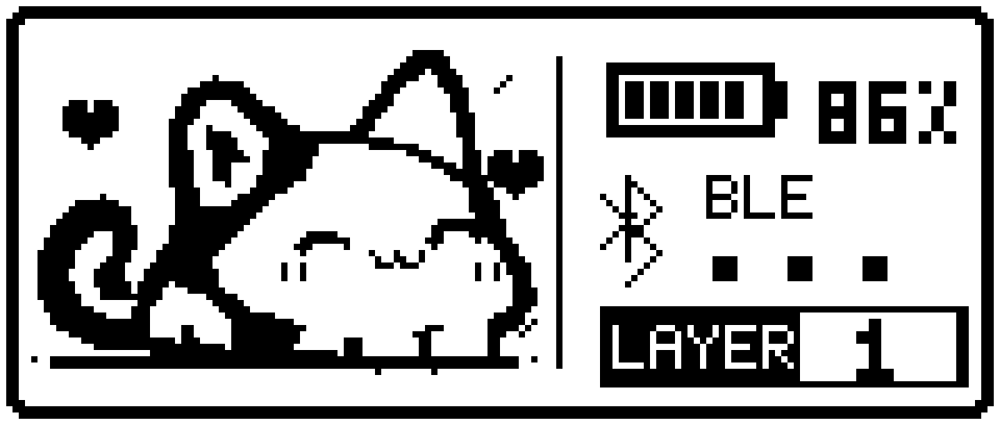

# 小猫咪主题

保留现有 160×68 像素猫咪主题，左右手共用：小猫咪、实时自身电量、与接收器的 BLE 连接状态、从 1 开始显示的层号。运行配置和渲染逻辑未改。



- `cat_display.c`：LVGL 界面与状态读取。
- `cat_frame.h`、`cat_art.h`、`cat_l8.h`：像素绘制、静态素材和 L8 展开。
- `cat_layer.h`、`cat_layer_relay.c`：原有层状态协议和接收器转发。
- `CMakeLists.txt`：保留 `VELVET_CAT_DISPLAY` 和 Nano 接收器的编译条件。
- `tests/test_cat_display.c`：宿主渲染边界、状态与图像展开检查。
- `tools/draw_cat.py`：可选 Pillow 工具，重新生成本目录的 `cat_art.h`。

在仓库根目录执行宿主检查：

```sh
cc -std=c11 -Wall -Wextra -Werror -Isrc/display/themes/cat src/display/themes/cat/tests/test_cat_display.c -o /tmp/test-cat
/tmp/test-cat
```

素材生成：`python3 src/display/themes/cat/tools/draw_cat.py`（需要 Pillow）。

小猫咪素材与渲染器保持原样，由共用 dashboard_screen.c 管理。DYA 的整套主题值 theme_set=0 选择左右均为小猫咪；theme_set=1 选择左 Codex、右系统。默认是整套小猫咪。双手猫咪套装和显示配置已由用户于 2026-10-19 在本次对话确认实机验证通过。

本目录是左右共用的一套主题，左右各自显示本手状态；素材与渲染逻辑保持原样。
