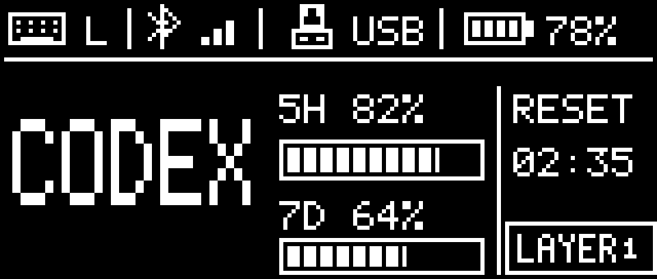
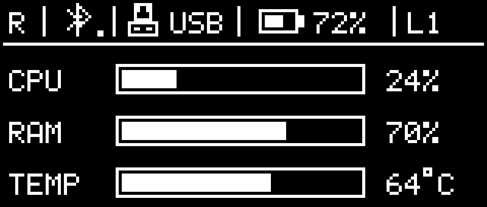

# 额度＋系统：整套简洁主题

同一套主题：左手显示 5H、7D、RESET 三行，右手显示 CPU、RAM、TEMP 三行。移除 CODEX 大字、CPU 趋势图和底部层号框；顶部统一显示本手 L/R、BLE 状态、USB 传输标记、电量和 L1 层号。

两页均使用实际 160×68 C 绘图器输出。进度条采用纯色填充。5H/7D 为剩余额度；RESET 条为距 5 小时窗口重置的剩余时间占比；TEMP 条按 0–100°C 映射、超出范围仅饱和进度条，文字仍显示实际温度，温度四舍五入至整数°C。未知数据保留空条和 `--`，不填入测试值。

DYA 的整套选择仍为 `theme_set=0` 左右猫咪、`theme_set=1` 额度＋系统。小猫咪素材和两手猫咪布局保持原样。预览不是实机屏摄；此次未触发构建。
