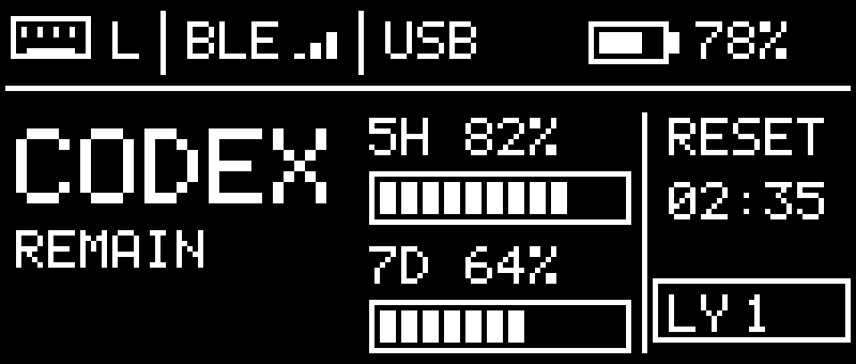

# Codex 额度主题

左手默认。160×68，显示本手电量、BLE split 连接状态、USB dongle 传输标记、5 小时/7 天剩余额度、5 小时窗口重置倒计时和从 1 开始的层号。BLE 信号柱只表示 split 已连接，不是测量的 RSSI。额度由配套 macOS 应用提供；未知和过期显示 `--`。

`render.h` 为独立像素渲染器。共用像素操作、数据结构和 LVGL 界面管理在 `../../common/` 及 `../../dashboard_screen.c`；不分配专属图像缓冲。
