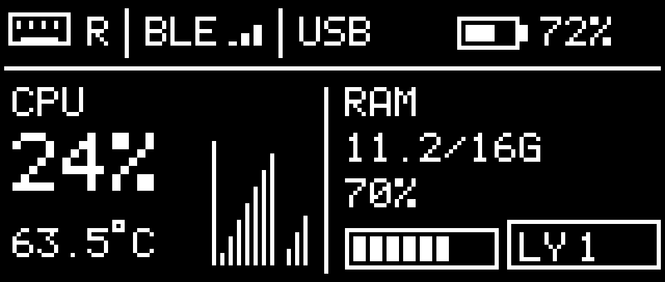

# 系统信息主题

右手默认。160×68，显示本手电量、BLE split 连接状态、USB dongle 传输标记、CPU 使用率及最近 12 次电脑采样、CPU 温度（°C）、内存用量/总量、内存百分比和当前层号。BLE 柱不是 RSSI，USB 是所用传输方式标记，不表示实时枚举状态。

CPU 温度有独立有效标记，无法读取时显示 `--°C`，不会拿天气、GPU、电池温度或占用率替代。Mac 应用使用 AppleSMC CPU 键，机型支持情况需实测；Apple Silicon 可能不提供默认键。内存采用 active+wired+compressed，和 macOS 内存压力不是同一个指标。

`render.h` 为独立像素渲染器，不分配专属缓冲。宏观布局按用户参考图重排，以实际 160×68 像素为准。
